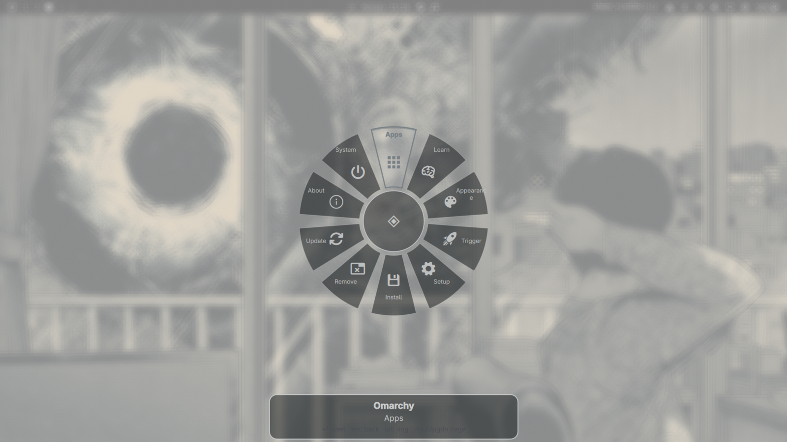
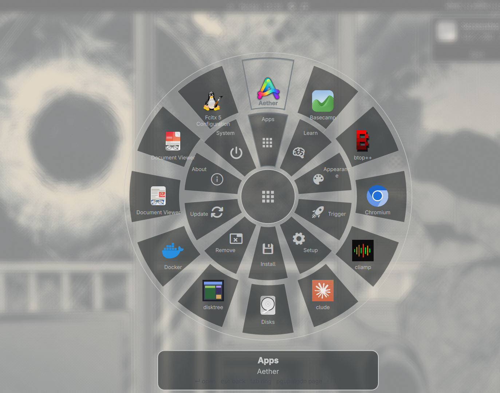
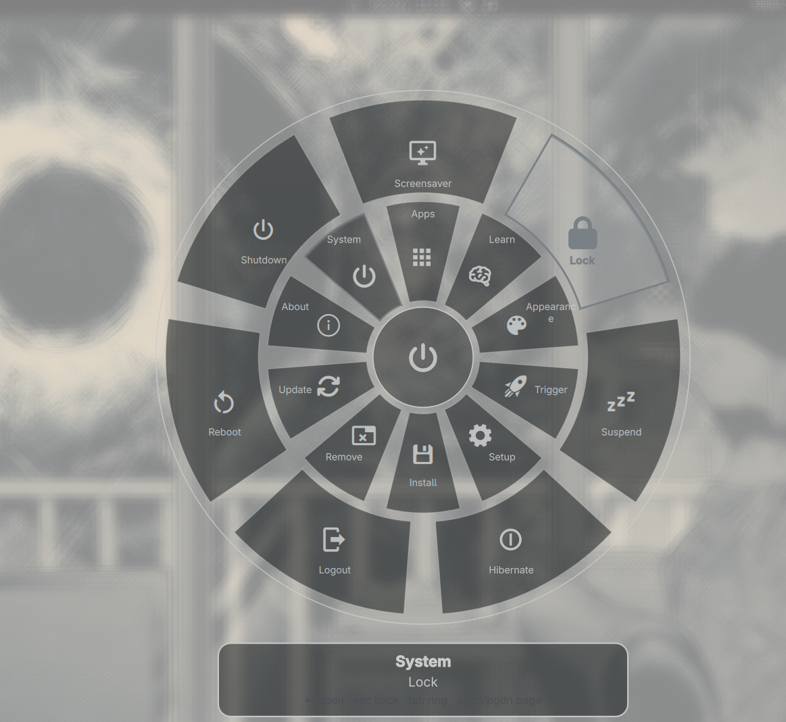

```text
 ▄█    █▄   ▄█   ▄█▀▀▀█▄   ▄████████    ▄████████    ▄████████ ▄█  ███▄▄▄▄      ▄████████ ███    █▄
███    ███ ███  ███▀▀▀███ ███    ███   ███    ███   ███    ███ ███  ███▀▀▀██▄   ███    ███ ███    ███
███    ███ ███▌ ███    ███ ███    █▀    ███    █▀    ███    █▀  ███  ███   ███   ███    █▀  ███    ███
███    ███ ███▌ ███    ███ ███         ▄███▄▄▄       ███        ███  ███   ███  ▄███▄▄▄     ███    ███
███    ███ ███▌ ███    ███ ███        ▀▀███▀▀▀     ▀███████████ ███  ███   ███ ▀▀███▀▀▀     ███    ███
███    ███ ███  ███    ███ ███    █▄           ███          ███ ███  ███   ███   ███    █▄  ███    ███
███    ███ ███  ███    ███ ███    ███    ▄█    ███    ▄█    ███ ███  ███   ███   ███    ███ ███    ███
 ▀██████▀  █▀    ▀██████▀  ████████▀   ▄████████▀   ▄████████▀  █▀    ▀█   █▀    ████████▀  ████████▀

                    ━━━━━━━━  Vice City Radial Launcher · an Omarchy plugin  ━━━━━━━━
```

<div align="center">

# Vice City Radial Launcher

[](https://github.com/Aprabin98/omarchy-vice-city-radial)
[](LICENSE)
[](https://github.com/basecamp/omarchy)
[](#how-it-works)

Plugin id `aprabin98.vice-city-radial` · made by [Prabin Acharya](https://github.com/Aprabin98).

</div>

A Vice City-style radial launcher for Omarchy. Press one key and the Omarchy
menu, your installed applications, and your open windows appear as a wheel:
categories on the inner ring, the selected category's entries on the outer
ring. Just start typing to search all of them at once.

The launcher runs **inside `omarchy-shell`** as an overlay plugin. It does not
start a second Quickshell process, does not edit your Hyprland configuration,
and does not install a background service.

<p align="center">
  
</p>

<p align="center">
  
  &nbsp;
  
</p>

## Features

- 🎡 **Two-ring wheel**: Omarchy menu categories on the inner ring, their
  entries on the outer ring; open a submenu to keep moving deeper.
- ⌨️ **Type to search** menu actions, installed applications, and open windows
  in one query. Results are grouped, with apps before windows before system
  actions, and exact matches always beat fuzzy ones.
- 🖱️ **Mouse, keyboard, and numbered slots**: hover to select, or use arrows,
  `Tab`, `Page Up`/`Page Down`, and `1`–`0`.
- 🧠 **Reads the real Omarchy menu**: merges
  `omarchy-menu.jsonc` with your user extensions, and evaluates `when`
  conditions so unavailable actions stay hidden.
- 🚀 **Launches real applications and focuses real windows** through your
  existing Omarchy and Hyprland tooling.
- 🎨 **Follows your theme**: reads Omarchy theme colors and shell overrides,
  with optional per-user color and layout overrides.
- 🪶 **No dependencies to install**, no network access, and no data
  collection. It is a QML overlay in the shell you already run.

## Requirements

- Omarchy with the Quattro shell and Hyprland.
- Quickshell (supplied by Omarchy; the plugin uses the running shell).
- Omarchy's menu data at
  `$OMARCHY_PATH/default/omarchy/omarchy-menu.jsonc`. When `OMARCHY_PATH` is
  unset, `/usr/share/omarchy` is used.
- `gtk-launch` and `uwsm-app` to start desktop applications.
- A Nerd Font for the menu glyphs. `JetBrainsMono Nerd Font` is the default;
  set another family in the config if you use a different one.

## Install

```bash
omarchy plugin add https://github.com/Aprabin98/omarchy-vice-city-radial.git --enable
```

Then bind it. Add this line to `~/.config/hypr/bindings.lua`:

```lua
o.bind("ALT + SPACE", "Vice City Radial Launcher", "omarchy-shell shell toggle aprabin98.vice-city-radial")
```

Reload Hyprland:

```bash
hyprctl reload
```

Press **Alt + Space** to open or close the wheel.

### If you use Prabin's Omarchy setup

The setup repository already manages an `Alt + Space` binding:

```bash
cd ~/omarchy-setup
./bin/omarchy-setup install launcher
```

The installed `omarchy-launcher` command opens the plugin when it is present
and otherwise falls back to the standalone wheel.

### Commands

```bash
omarchy-shell shell toggle aprabin98.vice-city-radial   # open or close
omarchy-shell shell summon aprabin98.vice-city-radial   # open
omarchy-shell shell hide aprabin98.vice-city-radial     # close
omarchy-shell omarchy-launcher status                   # inspect the wheel
omarchy-shell omarchy-launcher ping
```

`omarchy plugin update aprabin98.vice-city-radial` updates the plugin.

## Use

| Key or action | Result |
| --- | --- |
| Letters and punctuation | Search menu entries, apps, and windows |
| Up / Left, Down / Right | Select the previous / next item on the active ring |
| Tab | Switch between the inner and outer ring when not searching |
| Enter or Space | Open a submenu or run the selected item |
| `1`–`9`, `0` | Select that numbered slot on the current ring or page |
| Page Up / Page Down | Move through outer-ring pages |
| Backspace | Remove a search character, or go up one menu level |
| Escape | Clear search, then go up one level, then close |
| Click the center | Clear search or go up one level |
| Click outside the wheel | Close the launcher |
| Hover an item | Select it (when `mouseNavigation` is enabled) |
| Click an item | Run it or open its submenu |

Selecting a menu entry runs its Omarchy action. Selecting an application
launches its desktop entry. Selecting an open window focuses it.

## Configuration

Defaults work without a config file. To customize, copy the example:

```bash
mkdir -p ~/.config/omarchy-launcher
cp ~/.config/omarchy/plugins/aprabin98.vice-city-radial/config.json \
   ~/.config/omarchy-launcher/config.json
```

The launcher watches the file and applies changes on the next open.

```json
{
  "radius": 238,
  "iconSize": 44,
  "animationMs": 110,
  "mouseNavigation": true,
  "keyboardNavigation": true,
  "colors": {
    "pink": "#b784ff",
    "purple": "#7548bd",
    "text": "#f5efff",
    "backgroundAlpha": 0.5
  },
  "pageSize": 12,
  "iconFont": "JetBrainsMono Nerd Font"
}
```

| Key | Meaning |
| --- | --- |
| `radius` | Outer wheel radius in logical pixels; it shrinks to fit the monitor. |
| `iconSize` | Maximum size for icons and menu glyphs. |
| `animationMs` | Fade duration in milliseconds. |
| `mouseNavigation` | Allow pointer movement to change the selection. |
| `keyboardNavigation` | Enable keyboard control while the wheel is open. |
| `pageSize` | Outer-ring entries per page (minimum 4). |
| `iconFont` | Font used for menu glyphs; a Nerd Font is recommended. |
| `colors` | Optional overrides: `text`, `pink`, `purple`, `muted`, `background`, `selectedBackground`, `selectedText`, `border`, and `backgroundAlpha` (0–1). |

Empty or missing colors fall back to the current Omarchy theme.

## How it works

```text
omarchy-shell (Quickshell)
└── aprabin98.vice-city-radial (overlay)
    ├── Overlay.qml      plugin lifecycle: open / close / toggle
    ├── Radial.qml       wheel, menu parsing, search, input, theme
    ├── Slot.qml         one icon + label on a ring
    └── menu.js          JSONC parsing, tree building, when evaluation, ranking
```

At startup the plugin reads Omarchy's menu file and your
`~/.config/omarchy/extensions/omarchy-menu.jsonc` overrides. `when`
conditions run in one batched subprocess, and their results are reused until
the menu files change. Applications come from installed desktop entries;
windows come from Quickshell's Hyprland integration.

There is no installer script and no background daemon. Installing or removing
the plugin is handled entirely by `omarchy plugin`.

## Troubleshooting

- **Nothing happens on Alt + Space**: check the binding with
  `hyprctl binds | grep -i "ALT.*SPACE"` and run
  `omarchy-shell shell toggle aprabin98.vice-city-radial` in a terminal.
- **The plugin is not listed**: `omarchy plugin list | grep vice-city` and
  `omarchy plugin validate ~/.config/omarchy/plugins/aprabin98.vice-city-radial`.
- **QML errors**: `omarchy-shell shell rescanPlugins`, then inspect
  `qs log -p "$OMARCHY_PATH/shell" --tail 100`.
- **No menu entries**: confirm
  `$OMARCHY_PATH/default/omarchy/omarchy-menu.jsonc` exists. The plugin
  falls back to `/usr/share/omarchy` when `OMARCHY_PATH` is unset.
- **Applications do not start**: check that `gtk-launch`, `uwsm-app`, and the
  application's desktop entry are available.
- **Icons are missing**: install a Nerd Font, or set `iconFont` to a Nerd Font
  family you already use.

## Uninstall

```bash
omarchy plugin remove aprabin98.vice-city-radial
```

Remove the `Alt + Space` binding from `~/.config/hypr/bindings.lua` and run
`hyprctl reload`. The plugin does not touch that file, so it is never removed
for you. Your `~/.config/omarchy-launcher/config.json`, if you created one, is
also left alone.

## Development

The plugin entry is `Overlay.qml`; the wheel lives in `Radial.qml` and ring
items in `Slot.qml`. Check the menu parser against the installed Omarchy menu:

```bash
OMARCHY_PATH="${OMARCHY_PATH:-/usr/share/omarchy}" node tests/menu.test.js
```

Changes under `~/.config/omarchy/plugins/` hot-reload, but Qt's component
cache can keep the old compiled QML. Run `omarchy restart shell` after editing
the plugin.

## License

MIT. See [LICENSE](LICENSE).

Omarchy and Quickshell are separate projects with their own licenses.
